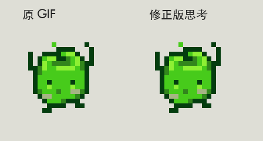

# 绿色祝尼魔2 / Green Junimo 2

可复现的 ChatGPT Work Pets 像素宠物同人项目。代码采用 MIT；角色和图像素材的权利范围见 [NOTICE.md](NOTICE.md)。这是非官方项目，与 ConcernedApe 或 OpenAI 没有隶属或背书关系。



## 直接使用

下载 [release/green-junimo-2.png](release/green-junimo-2.png)。这是完整的透明精灵图，不是预览截图。

在有 Pets 功能的 ChatGPT Work 会话中上传此 PNG，并要求：

> 请验证并使用这张现成的 v2 精灵图创建、启用一个名为“绿色祝尼魔2”的新宠物。保留现有像素和动画，不要重新绘制，不要修改已有宠物。

接收者需要自己的 Pets 访问权限；仓库不会自动替他安装或登录。这个项目不包含私有 API 凭证或任何人的宠物 ID。是否可以上传、创建和启用，取决于接收者当前可用的 Pets 工具。

## 一条命令复现

需要 Python 3.10 或更高版本。先安装依赖：

```sh
python -m venv .venv
# macOS / Linux:
source .venv/bin/activate
# Windows PowerShell 改用：.venv\Scripts\Activate.ps1
python -m pip install -r requirements.txt
```

然后运行：

```sh
python scripts/build.py
```

输出在 `build/`：完整 PNG、九种状态的 GIF、校验报告。无需 API key、AI 绘图服务、系统字体、ffmpeg 或原作者的电脑路径。Windows 若使用 `py` 启动器，可先运行 `py -m venv .venv`。

```sh
python -m unittest discover -s tests -v
```

复现基准是**解码后的 RGBA 像素一致**。PNG 压缩字节可能随编码器版本而不同。每个输入帧均有 SHA-256，完整图像另有 RGBA SHA-256；源帧被修改会明确报错。

## 动作设计

| 状态 | 帧数 | 表现 |
| --- | ---: | --- |
| idle | 6 | 待机与眨眼 |
| running-right / running-left | 各8 | 左右行走 |
| waving | 4 | 举手庆祝 |
| jumping | 5 | 同一完整姿势按像素格升降，不挤压拉伸 |
| failed | 8 | 出现问题，显示感叹号 |
| waiting | 6 | 等待输入，显示感叹号 |
| running | 6 | 正在思考，原 GIF 的举臂及交替抬脚 |
| review | 6 | 完成，高举红白献祭包 |
| look | 16 | 十六个视线方向 |

画布为 1536×2288，8列×11行，单格192×208；共73个有效帧。像素落在4px网格上，透明度为0或255；未用格保持透明。原 GIF 的3px像素块等比放大成8px块。

思考状态使用原 GIF 的四帧，六格次序为 `[0,0,1,2,2,3]`，重复抬脚帧而非落地帧。预览时长 `[70,80,150,70,80,150]` 毫秒合并为原始四帧各150毫秒。**Pets 内实际播放速度由应用控制，上传接口不支持逐帧时长设置。**

## 复现范围与修改

本仓库保存经确认的最终帧，构建时只拼接已有像素。它可复现最终设计，不能保证用同一个提示词重新生成一模一样的 AI 图像。早期部分素材使用 AI 生成，思考动作来自用户提供的原 GIF；原始随机生成过程不属于确定性构建步骤。

修改 `assets/frames/` 会触发校验失败，这是防止无意改变设计的检查。要制作自己的版本，应明确更新 `manifest.json` 中相应输入校验和与整体 RGBA 校验和，并人工检查动画。发布修改版时保留素材权利说明，不应把第三方游戏角色宣布为自己原创。

`previews/` 用于查看；`release/` 可直接导入；`assets/frames/` 是可重建源；`manifest.json` 是版式、帧序、时长与校验基准。GitHub Actions 在 Linux、Windows、macOS 上执行构建和检查。

## English quick start

Install Python 3.10+, run `python -m pip install -r requirements.txt`, then `python scripts/build.py`. The approved 73 source frames reconstruct the exact RGBA pixels without an AI service. Upload `release/green-junimo-2.png` to your own compatible Pets session to create a new pet. Runtime animation timing is controlled by the host app. Code is MIT; artwork and underlying Stardew Valley IP are **not** licensed under MIT. See [NOTICE.md](NOTICE.md).
